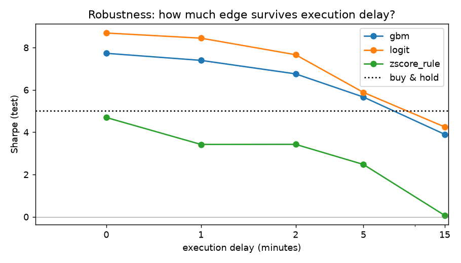
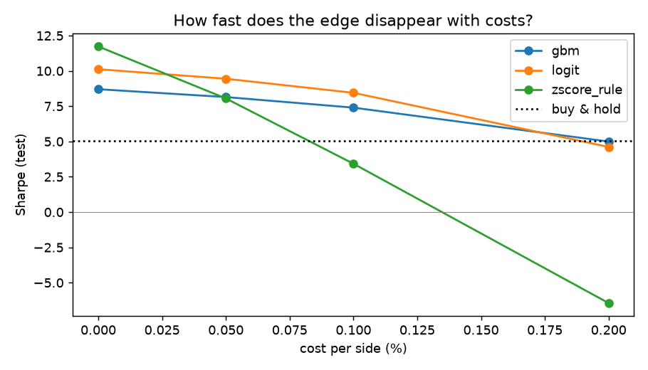
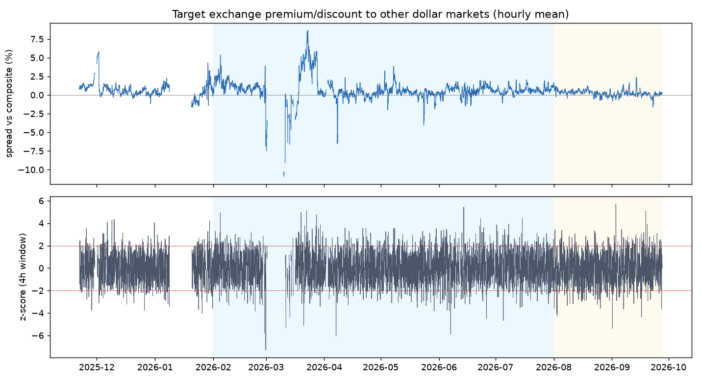
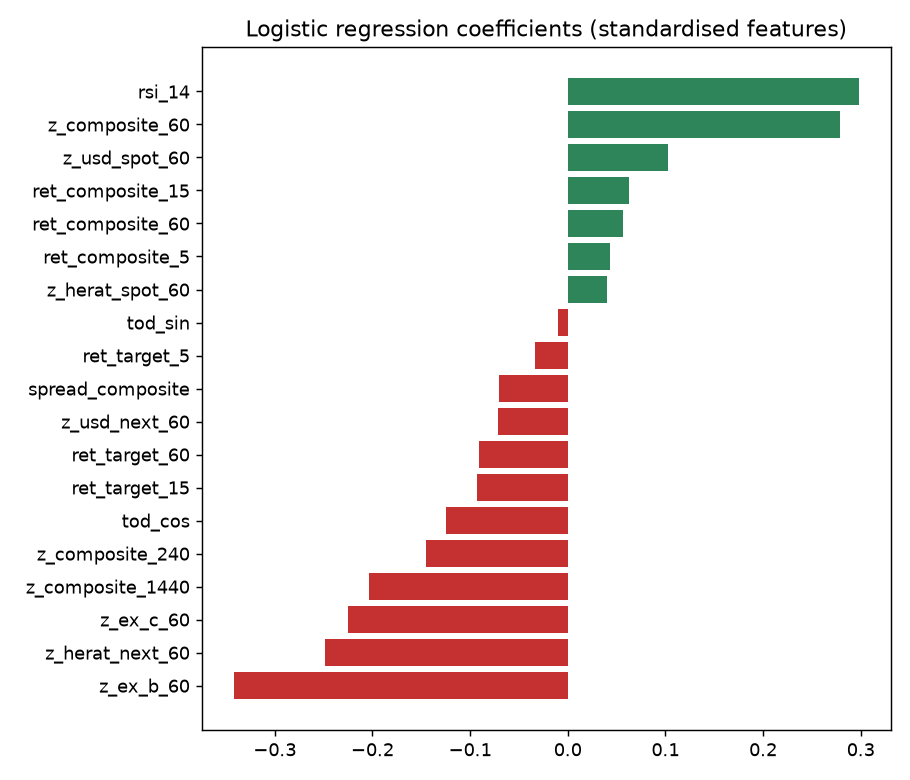

# Cross-Market Spread Signals in the Iranian USDT/IRT Market

*A time-series classification study with walk-forward validation*

Iran has several parallel markets for "the dollar": crypto exchanges that quote
USDT against the rial (IRT), the Tehran open currency market, and the Herat
market in Afghanistan. They usually move together, but at the one-minute level
they often disagree. This project asks one research question:

> **When one exchange's USDT/IRT price moves unusually far from the other
> dollar markets, can that gap predict the direction of its next 60 minutes,
> and does the prediction survive realistic trading frictions?**

This is a research project, not a trading product. It reports risk and
accuracy metrics (Sharpe ratio, drawdown, precision/recall), not profits.
The parameters here are generic research baselines, not a live configuration.

---

## 1. Problem

* **Input:** 1-minute prices from 7 markets (1 target exchange + 6 references).
* **Target:** will the target exchange's price rise by more than a round-trip
  transaction cost (0.2%) over the next 60 minutes? (binary classification)
* **Why it is interesting:** in an integrated market, gaps between venues
  should close quickly (the law of one price). How fast and how reliably they
  close tells us something about market efficiency and liquidity in a
  capital-controlled economy.

## 2. Data

| | |
|---|---|
| Period | 21 Nov 2025 – 27 Sep 2026 (~10 months) |
| Frequency | 1 minute (≈ 404,000 usable minutes after cleaning) |
| Markets | target exchange, 2 other Iranian crypto exchanges, Tehran USD (same-day and next-day settlement), Herat USD (same-day and next-day) |
| Collection | my own collectors, which polled public price endpoints and stored snapshots in PostgreSQL |

**Cleaning** ([`data.py`](src/usdtirt/data.py)): align to a 1-minute UTC grid;
forward-fill holes of ≤5 minutes only; drop one-minute jumps above 5%; treat a
crypto price frozen for 2+ hours as a dead feed; split the series into
**segments** at every gap longer than 30 minutes (28 segments), so that no
rolling statistic or trade spans an outage.

**The raw data is not published.** It was collected from third-party
exchanges whose terms restrict redistribution, and exchange names are replaced
with neutral labels (`target`, `ex_b`, `usd_next`, …). To run the code, use the
**synthetic generator**, which produces data with the same schema
([`make_synthetic_data.py`](scripts/make_synthetic_data.py)).

## 3. Method

**Features** ([`features.py`](src/usdtirt/features.py)). Each one uses only past data:

* **Spread** of the target vs. a *composite* reference (the median of the six
  other markets; the median ignores a single stale or wrong quote).
* **Rolling z-score** of that spread over 1h, 4h and 24h: "how unusual is
  today's gap compared with the recent past?"
* Per-reference 1h z-scores, which show *which* market disagrees.
* Recent returns of the target and the composite (5, 15, 60 min), RSI-14, and
  time of day (encoded on a circle).

**Three models** ([`strategies.py`](src/usdtirt/strategies.py)), from simplest
to most flexible:

1. **Z-score rule.** Buy when the target is ≥ *k* standard deviations cheap
   relative to the composite; exit when the gap closes or after a time limit.
   Fully transparent.
2. **Logistic regression.** A linear, interpretable classifier.
3. **Gradient-boosted trees.** Shallow trees (depth 3) that can capture
   non-linear effects.

**Backtest** ([`backtest.py`](src/usdtirt/backtest.py)): long/flat only, since
the spot market offers no shorting. A position is taken **one minute after**
the signal. Every entry and exit pays a cost (0.1% per side in the base case).

## 4. Validation

Financial time series make it easy to fool yourself. These are the safeguards:

| Risk | Safeguard |
|---|---|
| Look-ahead bias | Features use only data up to *t*; the position is entered one minute later. A unit test changes future prices and checks that past features do not change ([`tests/`](tests/test_pipeline.py)). |
| Overfitting through tuning | The time split was fixed first. **Validation** (Feb–Jul 2026) is used for *all* choices (rule parameters, probability thresholds). **Test** (Aug–Sep 2026) is used once. |
| Training on the future | **Walk-forward**: the models are retrained every month using only earlier data, with a 60-minute *embargo* so training labels never overlap the test month. |
| Hidden trading frictions | Results are reported across four cost levels and five execution delays. |
| Too many attempts | 24 rule configurations were tried; all are published in [`results/rule_grid_validation.csv`](results/rule_grid_validation.csv). |

## 5. Results

Base case: 0.1% cost per side, 1-minute execution delay. Buy-and-hold on the
same period is the benchmark.

| Model | Period | Sharpe | Max drawdown | Trades | Win rate | Profit factor | Precision | Recall |
|---|---|---:|---:|---:|---:|---:|---:|---:|
| Z-score rule | Validation | 1.37 | −11.8% | 241 | 71% | 1.91 | 0.29 | 0.18 |
| Logistic | Validation | 3.61 | −6.7% | 151 | 63% | 3.45 | 0.37 | 0.07 |
| Gradient boosting | Validation | 3.39 | −6.1% | 143 | 69% | 2.75 | 0.33 | 0.07 |
| *Buy & hold* | *Validation* | *2.24* | *−19.7%* | | | | *0.23 base rate* | |
| Z-score rule | Test | 3.42 | −5.0% | 94 | 66% | 3.27 | 0.25 | 0.22 |
| Logistic | Test | 8.45 | −2.0% | 36 | 83% | 7.49 | 0.53 | 0.09 |
| Gradient boosting | Test | 7.40 | −1.4% | 23 | 96% | 56.7 | 0.55 | 0.07 |
| *Buy & hold* | *Test* | *5.02* | *−6.6%* | | | | *0.17 base rate* | |

Out-of-sample ROC-AUC: logistic 0.65 (validation) / 0.67 (test); gradient boosting 0.67 / 0.70.

**How to read this:**

* **There is real, weak predictability.** An AUC of 0.65–0.70 is modest.
  However, when the models do signal, they are right 33–55% of the time,
  against a 17–23% base rate. The models are selective: recall is low, and
  they sit out most moves.
* **The simple rule does not beat buy-and-hold on validation** (Sharpe 1.37 vs 2.24).
  The rial weakened over the period, so simply holding USDT was a strong benchmark.
  The two classifiers beat it on validation while being in the market only about 5% of the time.
* **The test numbers are too good to trust.** They rest on 23–36 trades over
  two months. A profit factor of 56 on 23 trades is noise, not skill. The
  **validation** results, based on six months and more than 140 trades, are the honest estimate.




* **Frictions matter a lot.** The simple rule loses its whole edge with a
  15-minute delay, or with a 0.2% cost per side (Sharpe falls to −6.4).
  The classifiers degrade more gracefully, because they trade less.
  Much of the apparent edge in a naive 1-minute backtest is market
  microstructure. This was the most important thing the robustness checks revealed.




**What the model learned** (logistic coefficients, standardised). The target
tends to rise after it has become *cheap relative to the other crypto
exchanges* (negative weights on `z_ex_b_60`, `z_ex_c_60`), which is
mean-reversion *between* venues. At the same time, short-term momentum within
the hour (positive weights on `z_composite_60`, `rsi_14`) also helps.
Several features are correlated, so individual coefficients should not be
over-interpreted.

**A check of a live prototype.** A rule-based prototype of this idea logged
7,224 signals between July and September 2026. Of its BUY signals, 63% were
followed by a higher price 60 minutes later (base rate 51%). Of its SELL
signals, 60% were followed by a lower price. These signals overlap in time, so
they are not 7,224 independent observations.

## 6. Limitations

* **Short history, one regime.** Ten months do not cover a full market
  cycle. Most of the period saw a steadily weakening rial, and results in a
  sharp rial rally or a crash could differ.
* **The test period is small.** Two months and at most 94 trades. Confidence
  intervals are wide, and no claim should rest on test-set numbers alone.
* **The backtest is not trading.** Prices are one-minute snapshots of the
  last or mid price, not executable order-book quotes. The backtest ignores
  queue position, partial fills, **liquidity limits** (the order book on
  these exchanges is thin), withdrawal limits, and exchange downtime.
* **Cost assumptions.** Real fees depend on account tier and maker/taker
  status. The results depend strongly on this number (see the cost figure).
* **Data quality.** Parallel dollar markets are reported by manual or
  semi-manual sources and close at night. Stale feeds were filtered with
  simple heuristics that are surely imperfect.
* **Multiple testing.** Even with a clean split, trying many ideas on the same
  10 months inflates the best result. Only 24 rule configurations and 5
  thresholds per model were searched, and all of them are reported.
* **Regulatory and structural shocks** (exchange restrictions, internet
  shutdowns, sanctions news) cause the largest moves, and they are not in the features.

## 7. What I learned

I started this project with a simple rule-based signal that looked excellent
on my own charts. Rebuilding it as a proper study taught me three things.

1. **Validation design matters more than the model.** The biggest changes in
   the results came from walk-forward splits, embargoes, and adding one minute
   of execution delay, not from swapping logistic regression for gradient boosting.
2. **A good-looking backtest is a hypothesis, not a result.** The naive
   1-minute backtest was mostly measuring market microstructure. Finding that
   out myself, through sensitivity analysis, was more valuable than any Sharpe ratio.
3. **Market structure is the real subject.** The questions I now find most
   interesting are not about the signal itself. Why do gaps between venues persist in a
   capital-controlled economy? How do liquidity and settlement rules (same-day
   vs. next-day) shape price discovery? And how should a regulator or an
   exchange measure market quality?

These questions sit where finance, data and technology meet. Answering
them properly needs what I do not yet have: econometrics for non-stationary
data, market microstructure theory, and a rigorous grounding in how financial
infrastructure and regulation work. That is why I am applying for an
**MSc in FinTech / Business Analytics**. I want to turn practical work on real
market data into research that is methodologically sound.

---

## Reproduce

```bash
pip install -r requirements.txt
python scripts/make_synthetic_data.py              # writes data/sample/prices_synthetic.csv.gz
python scripts/run_research.py --prices data/sample/prices_synthetic.csv.gz --out results_synthetic
pytest -q
```

The synthetic market has a built-in mean-reverting spread, so its numbers are
much stronger than the real ones and say nothing about the real market.
The figures above come from the private dataset.

## Repository layout

```
src/usdtirt/
  data.py          load + clean the 1-minute panel, split at data gaps
  features.py      spreads, rolling z-scores, returns, RSI, forward-return label
  strategies.py    z-score rule, walk-forward classifiers
  backtest.py      long/flat backtest with costs + delay; Sharpe, drawdown, trade stats
scripts/
  run_research.py        the whole study: selection on validation -> test -> figures
  make_synthetic_data.py synthetic data with the same schema
tests/test_pipeline.py   look-ahead, delay, cost and rule tests
results/                 tables (.csv, summary.json) and figures from the real data
```

## Author

Erfan Tahernejad. BSc Computer Science (University of Guilan), MSc IT
(E-commerce, in progress). Financial markets analyst in the Iranian crypto industry.
